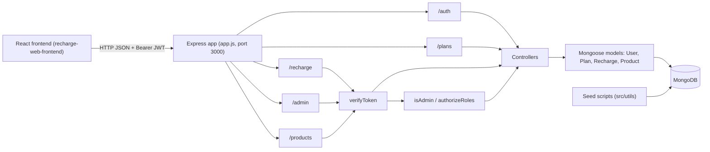

# Recharge Web – Backend

The REST API behind a mobile recharge web application: user accounts, recharge plans, recharge transactions and an admin dashboard, built with Node.js, Express and MongoDB.


## Overview

This project is one half of a full-stack mobile recharge application, split across two repositories:

| Repository | Role |
|---|---|
| **recharge-web-backend** (this repo) | Express REST API and MongoDB data layer |
| [recharge-web-frontend](https://github.com/suriyaprakash-25/recharge-web-frontend) | React + Tailwind single-page app that users and admins interact with |

The application recreates the core experience of a telecom operator's online recharge portal (the UI is themed after Airtel; this is a learning project with no affiliation to any operator). A customer signs up with a phone number, browses Individual and Family plans, "pays" with UPI, card or wallet, and sees a history of recharges. An administrator manages the plan catalogue and views users, transactions and revenue analytics.

This backend owns everything that must be persisted or protected: password hashing, JWT issuance and verification, role checks, plan storage, recharge records and admin reporting queries.

> Payments are **simulated**: there is no payment gateway or operator integration. A recharge request is stored directly with status `Success`.

## Key features

- **Phone-number based accounts**: register with name, phone number, email and password; log in with phone number and password. Passwords are hashed with bcrypt; JWTs (7-day expiry) carry the user ID and role.
- **Role-based access**: `USER` and `ADMIN` roles enforced by `verifyToken`, `isAdmin` and `authorizeRoles` middleware.
- **Plan catalogue**: public endpoint listing plans sorted by price; admin create, update and delete. Plans have price, validity (days), data, calls, SMS and a category (`Individual` or `Family`).
- **Recharges**: authenticated users create recharge records (plan, amount, validity, data, target phone number, payment method and masked payment details) and fetch their own history.
- **Admin analytics**: total users, total recharges, total revenue, recharges in the last 30 days, revenue and count per payment method, and monthly revenue for the last six months (MongoDB aggregation pipelines).
- **Seed scripts**: load sample Individual and Family plans into a local or Atlas database.
- **Products CRUD**: a generic `/products` resource with admin-only writes. It is not used by the frontend and appears to be an earlier exercise kept in the codebase.

## Architecture



| Component | Responsibility |
|---|---|
| [`app.js`](app.js) | Creates the Express app, enables CORS and JSON parsing, connects to MongoDB and mounts the five routers. |
| [`src/config/db.js`](src/config/db.js) | Connects Mongoose using `MONGO_URI`; exits the process on failure. |
| [`src/routes/`](src/routes) | URL definitions and middleware chains per resource. The public plan list is implemented inline in `planRoutes.js`. |
| [`src/middleware/`](src/middleware) | `verifyToken` decodes the JWT into `req.user = { id, role }`; `isAdmin` and `authorizeRoles(...)` check the role. |
| [`src/controllers/`](src/controllers) | Business logic for users, recharges, admin features and products. |
| [`src/models/`](src/models) | Mongoose schemas for `User`, `Plan`, `Recharge` and `Product`. |
| [`src/utils/`](src/utils) | One-off scripts that insert sample plans. |

## How it works

1. **Sign up**: the frontend posts to `/auth/register`. The controller rejects duplicate phone numbers or emails, hashes the password, saves a `USER`, and returns a JWT plus the profile.
2. **Log in**: `/auth/login` looks the user up by phone number, compares the bcrypt hash and returns a JWT whose payload contains `id` and `role`. The frontend stores the token and sends it as `Authorization: Bearer <token>`.
3. **Browse plans**: `/plans` (public) returns every plan sorted by price; the frontend splits them into Individual and Family tabs.
4. **Recharge**: the frontend posts the selected plan, target number and payment method to `/recharge`. `verifyToken` attaches the user ID from the token, and the controller saves a `Recharge` with status `Success`. Card numbers are masked to the last four digits by the frontend before sending.
5. **History**: `/recharge/history` returns the current user's recharges, newest first.
6. **Admin**: an admin token unlocks `/admin/*` for user lists, all recharges, plan CRUD and a `/admin/stats` aggregation endpoint. (The current frontend builds its dashboard charts from `/admin/users`, `/admin/plans` and `/admin/recharges`; `/admin/stats` is available but not yet called.)

### Data model

| Model | Fields |
|---|---|
| `User` | `name`, `phoneNumber` (unique), `email` (unique), `password` (bcrypt hash), `role` (`USER` / `ADMIN`), timestamps |
| `Plan` | `name`, `price`, `validity` (days), `data`, `calls` (default `Unlimited`), `sms` (default `100/day`), `category` (`Individual` / `Family`), `isActive`, timestamps |
| `Recharge` | `userId` (ref User), `planName`, `amount`, `validity`, `data`, `phoneNumber`, `paymentMethod` (`UPI` / `Card` / `Wallet`), `paymentDetails` (`upiId`, `cardNumber`, `cardName`), `status` (`Pending` / `Success` / `Failed`), timestamps |
| `Product` | `name`, `price` |

## Tech stack

| Layer | Technologies |
|---|---|
| Runtime | Node.js (CommonJS modules) |
| Web framework | Express 5, cors |
| Database | MongoDB with Mongoose 9 |
| Auth | jsonwebtoken, bcryptjs |
| Config | dotenv |

## Project structure

```
recharge-web-backend/
├── app.js                       # Entry point: middleware, routers, listen on port 3000
├── package.json
└── src/
    ├── config/db.js             # MongoDB connection
    ├── controllers/
    │   ├── userController.js    # Register and login
    │   ├── rechargeController.js# Create recharge, user history, all recharges
    │   ├── adminController.js   # Users, stats, recharges, plan CRUD
    │   └── productController.js # Generic products CRUD (unused by frontend)
    ├── middleware/
    │   ├── authMiddleware.js    # verifyToken (JWT)
    │   └── roleMiddleware.js    # isAdmin, authorizeRoles
    ├── models/                  # userModel, planModel, rechargeModel, productModel
    ├── routes/                  # userRoutes (/auth), planRoutes, rechargeRoutes, adminRoutes, productRoutes
    └── utils/
        ├── seedPlans.js         # Seeds 6 plans into a local MongoDB (skips if plans exist)
        ├── seedPlansAtlas.js    # Same plans, using MONGO_URI
        ├── addMorePlans.js      # Adds two extra Individual plans
        └── addFamilyPlan.js     # Adds one extra Family plan
```

## Getting started

### Prerequisites

- Node.js and npm
- MongoDB (local instance or MongoDB Atlas)

### Install

```bash
git clone https://github.com/suriyaprakash-25/recharge-web-backend.git
cd recharge-web-backend
npm install
```

### Environment variables

Create a `.env` file in the project root (it is git-ignored):

| Variable | Purpose |
|---|---|
| `MONGO_URI` | MongoDB connection string |
| `JWT_SECRET` | Secret used to sign and verify JWTs |

The server port is fixed at `3000` in [`app.js`](app.js).

### Seed sample plans

```bash
node src/utils/seedPlansAtlas.js   # uses MONGO_URI
# or, for a local MongoDB at mongodb://127.0.0.1:27017/recharge-app
node src/utils/seedPlans.js
```

Optional extras: `node src/utils/addMorePlans.js` and `node src/utils/addFamilyPlan.js`.

### Run

There is no `start` script in `package.json`; run the entry file directly:

```bash
node app.js
```

The API listens on `http://localhost:3000`. To use it with the frontend, point the frontend's `API_BASE_URL` (in `src/services/api.js` of [recharge-web-frontend](https://github.com/suriyaprakash-25/recharge-web-frontend)) to this address.

### Tests

No automated tests are included (`npm test` is the npm placeholder).

## API reference

All request and response bodies are JSON. "User" and "Admin" mean a valid `Authorization: Bearer <token>` header is required, with the admin role for the latter.

| Method | Endpoint | Access | Description |
|---|---|---|---|
| POST | `/auth/register` | Public | Body: `name`, `phoneNumber`, `email`, `password`. Returns `token` and `user`. |
| POST | `/auth/login` | Public | Body: `phoneNumber`, `password`. Returns `token` and `user` (with `role`). |
| GET | `/plans` | Public | All plans, sorted by price ascending |
| POST | `/recharge` | User | Create a recharge for the logged-in user |
| GET | `/recharge/history` | User | Current user's recharges |
| GET | `/recharge/all` | User | All recharges (see Limitations) |
| GET | `/admin/stats` | Admin | Dashboard statistics |
| GET | `/admin/users` | Admin | All users (without passwords), total and last-30-days counts |
| GET | `/admin/recharges` | Admin | All recharges with user info |
| GET | `/admin/plans` | Admin | All plans, newest first |
| POST | `/admin/plans` | Admin | Create a plan |
| PUT | `/admin/plans/:id` | Admin | Update a plan |
| DELETE | `/admin/plans/:id` | Admin | Delete a plan |
| GET | `/products`, `/products/:id` | User | List or get products |
| POST, PUT, DELETE | `/products`, `/products/:id` | Admin | Manage products |

Example: create a recharge

```http
POST /recharge
Authorization: Bearer <token>
Content-Type: application/json

{
  "planName": "Prepaid 449",
  "amount": 449,
  "validity": "28 days",
  "data": "2GB/day",
  "phoneNumber": "9876543210",
  "paymentMethod": "UPI",
  "paymentDetails": { "upiId": "name@upi" }
}
```

Response (`201`):

```json
{
  "message": "Recharge successful",
  "recharge": { "_id": "...", "userId": "...", "planName": "Prepaid 449", "amount": 449, "status": "Success", "createdAt": "..." }
}
```

Example: `GET /admin/stats` response shape

```json
{
  "message": "Dashboard stats retrieved successfully",
  "stats": {
    "totalUsers": 0,
    "totalRecharges": 0,
    "totalRevenue": 0,
    "recentRecharges": 0,
    "rechargesByMethod": [{ "_id": "UPI", "count": 0, "revenue": 0 }],
    "monthlyRevenue": [{ "_id": { "year": 2025, "month": 1 }, "revenue": 0, "count": 0 }]
  }
}
```

## Limitations and roadmap

This is a learning project. Known gaps visible in the code:

- **Simulated payments**: no payment gateway or telecom operator API; every recharge is saved as `Success`.
- **Hardcoded admin login**: the login controller contains a fixed admin phone number and password that create or promote an admin account on first use. Admin bootstrap should move to a seed script or environment variables, and the existing credential should be considered public.
- **Payment method casing**: the frontend sends `UPI`, `CARD` or `WALLET`, while the schema enum is `UPI`, `Card`, `Wallet`, so card and wallet recharges fail validation. Aligning the enum (or normalising input) would fix this.
- **`/recharge/all`** is protected by login only, not by the admin role.
- **`isActive`** exists on plans but the public `/plans` endpoint does not filter on it.
- `/admin/recharges` populates a `phone` field that does not exist on `User` (it should be `phoneNumber`).
- No input validation library, rate limiting, `.env.example`, `npm start` script or automated tests. The port is hardcoded.

Possible next steps: integrate a real payment gateway (for example Razorpay) with webhook-based status updates, move admin creation out of the login path, add request validation and tests, and add a `start` script and Dockerfile.

## Related repository

- Frontend: [suriyaprakash-25/recharge-web-frontend](https://github.com/suriyaprakash-25/recharge-web-frontend)

## Author

Built by [Suriyaprakash](https://github.com/suriyaprakash-25).
